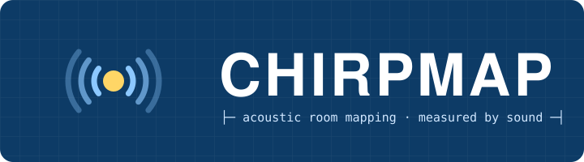
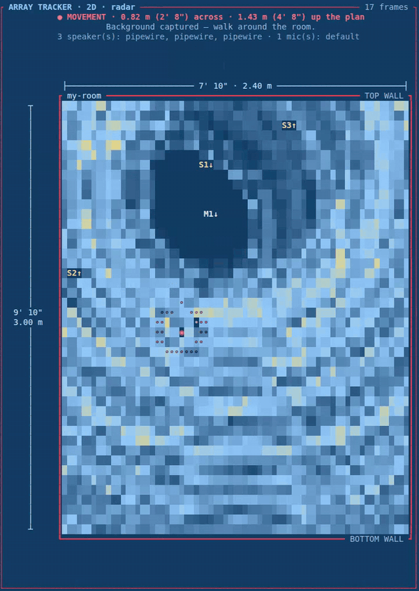

<p align="center"></p>


---


Terminal-native acoustic echolocation that maps rooms like blueprint - monitors changes, movement and activity, using any speaker and mic. Fully offline. Written in Rust.  Efficiency and accuracy results vary greatly depending on device microphone and speaker equality and ability along with room setup.  Future versions will allow multi speaker, microphone, and device setup and array.

<p align="center">
  <br>
  <sub>Live array tracker: a soundbar + two Klipsch towers + one USB mic. Every red ping is a detected movement placed on the room's blueprint.</sub>
</p>

ChirpMap plays a short frequency sweep (a *chirp*) through your speaker, records the mic at the same time, and matched-filters the recording to find echoes. Rotate the device through a few headings and it builds a floor plan in your terminal, plus an SVG blueprint with dimensions and a title block.

---

***Notice: ChirpMap is experimental software provided "as-is" and under active development starting on 11-7-2026.  Because performance, accuracy, and acoustic results depend heavily on individual hardware capabilities and room enviroment, the authors assume no liability for hardware performance, audio adjustments, or measurement accuracy. User assumes any and all risk.***

---

## Set Up 

```

## Install

```bash
# Linux needs ALSA headers once:
sudo apt install libasound2-dev pkg-config     # Debian/Ubuntu
sudo dnf install alsa-lib-devel                # Fedora

cargo install --path .      # puts `chirpmap` on your PATH (~/.cargo/bin)
```

Then from any terminal, just type:

```bash
chirpmap
```

That opens the ChirpMap window: a full-screen app in your terminal showing the speaker and mic in use, calibration health, an arrow-key menu, and the live tracker drawn right inside it. (Pipe or script it and you get a plain text menu instead; `CHIRPMAP_PLAIN=1` forces that.) The menu has: live tracker, live echoes, calibrate, scan, hardware panel, simulator demo, and **update** (pulls the latest code and reinstalls). Ctrl+C in a live view returns to the menu. Scans from the menu are saved to `~/chirpmap-scans/`.

Every feature is also a direct command (`chirpmap ping --live --diff`, `chirpmap calibrate`, …). See `chirpmap --help`.

No network access is used at any point.

## Commands

| Command | What it does |
|---|---|
| `chirpmap devices` | **Hardware panel**: every speaker and mic, its sample rate, channels and format, what chirp band and range resolution it supports, and which ones are already calibrated |
| `chirpmap calibrate` | **Auto-calibration** for the current speaker+mic pair (below). Saves a profile that every later command uses automatically |
| `chirpmap ping [--live]` | One-direction range reading as a bar chart (the original `echo.py` view), in metres and feet/inches |
| `chirpmap ping --live --diff` | **Background subtraction**: captures the empty scene first, then shows only what *changed*, so a hand or book is the only thing on screen |
| `chirpmap scan` | Maps a room: turn the device clockwise through headings (8 × 45° by default), optionally at several spots |
| `chirpmap render scans/scan-….json [--svg out.svg]` | Redraws a saved scan |

Useful extras: `--blank <m>` overrides the calibrated blanking distance (on `ping` and `scan`), and `ping --dump rec.wav` saves the raw mic recording so you can see exactly what the mic heard (open it in Audacity).

ALSA prints dozens of harmless "unable to open slave" lines while probing devices; ChirpMap hides them. Set `CHIRPMAP_ALSA_DEBUG=1` to see them.

Every command takes `--output <# or name>` and `--input <# or name>` to choose devices (default: the system defaults), and `--sim` to run against a simulated 5.2 × 4.1 m room without any audio hardware.

## Auto-calibration

`chirpmap calibrate` adapts to whatever speaker and mic you have:

1. **Noise floor:** listens to the room for 1 s.
2. **Frequency band:** sweeps 1 kHz up to 20 kHz and keeps the widest band at least 10 dB above the noise (cheap laptop speakers often lose the top end).
3. **Volume:** the quietest level that reaches 35 dB SNR without clipping the mic.
4. **System levels (optional, asks first):** with your permission, and only up to a maximum speaker volume *you* choose, it tries mic sensitivity × speaker volume combinations and keeps the best one that doesn't clip.
5. **Ring-down and latency:** measures how long the speaker keeps ringing (that sets the blanking distance, since nothing closer can be seen) and how much the driver latency jitters. Every ping is aligned on its own direct speaker-to-mic arrival, so latency doesn't affect distances.

**Your levels always come back.** Before changing anything, ChirpMap saves your exact speaker and mic volumes (per channel) and mute states, and writes them to `~/.config/chirpmap/restore-levels.json`. They're restored when it finishes, on an error, on Ctrl+C, and even after a crash or power cut (the next `chirpmap` start restores them). Later `ping` and `scan` runs offer to use the calibrated levels and put yours back when you stop.

If the mic is digitally silent (wrong input, such as a `.monitor` or S/PDIF `iec958` source) or barely hears the speaker (under 20 dB SNR), calibration says why and **doesn't save** the profile. Add `--force` to save it anyway.

Profiles live in `~/.config/chirpmap/profiles/`.

### Linux: pick the right mic

`chirpmap` uses PipeWire's default input. Check it's a real microphone:

```bash
pactl get-default-source          # should NOT end in .monitor or be an iec958 input
pactl list short sources          # find your mic
pactl set-default-source <name>
```

Put the mic right next to the speaker, both facing the room (like a bat's mouth and ears).

## Scanning a room

```bash
chirpmap scan
```

1. Put the device somewhere open, ideally away from walls, and pick a "forward" direction (0°).
2. Press Enter at each heading, turning clockwise 45° each time.
3. When asked, enter another spot as an `x,y` offset in metres from the first (e.g. `1.5,0`) to fill in gaps, or press Enter to finish.

Each scan saves `scans/scan-<time>.json` (raw readings) and `scans/scan-<time>.svg` (blueprint).

### Measured vs. assumed vs. unscanned

- **Measured:** along the exact heading you pointed, the distance to the first echo is a real measurement. The path up to it is open, and the hit is a wall or object.
- **Assumed:** a speaker's sound spreads over a wide beam (`--beam`, default ±30°), so the echo could have come from anywhere in that cone. Those cells, and wall segments joining neighbouring hits, are drawn as assumed.
- **Unscanned:** cells inside the room's footprint that no reading reached.

Coverage % is computed over the footprint, the bounding box of every detected wall.

## Limits (honest version)

- One speaker and one mic give **distance, not direction**. Direction comes from which way you're pointing the device, which is why the beam cone is marked assumed. Built-in laptop speakers are close to omnidirectional, so expect a coarse map.
- Soft furnishings absorb high frequencies. Glass and bare walls give the strongest echoes.
- Range resolution is about 1–2 cm in theory and more like 5–10 cm in practice.

## Roadmap

- Two-mic arrays (stereo laptop mics, USB mic pairs): time-difference-of-arrival bearing, so the map stops depending on where you point the device
- Phone as a second, moving node
- Sensor fusion with Wi-Fi CSI, mmWave and thermal
- A live ratatui interface

## Origin

Grew out of `echo.py`, a Python proof of concept (chirp, matched filter, terminal bar chart). The same pipeline now lives in `src/dsp.rs`.


## Multi-speaker / multi-mic arrays (v0.7)

**Room designer** (menu `7`): draw your room to scale and place every speaker and microphone: where it sits, which way it faces, and which physical device it is (`n` cycles through your sound cards). Sizes show in metres and feet/inches. Saved to `~/.config/chirpmap/rooms/`.

**Array tracker** (menu `8`): uses every speaker → mic pair in the layout at once. Each pair turns an echo delay into a path length *speaker → object → mic*, which on the floor plan is an ellipse with the speaker and mic at its foci. ChirpMap back-projects every pair's echoes onto the plan; where pairs agree, the object lights up on a heat map and gets a position in feet and inches.

- 1 speaker + 1 mic = 1 pair (a distance, the direction is ambiguous)
- 2 speakers + 2 mics = 4 pairs (a real 2D fix: about 20 cm in the simulator)
- Speakers take turns pinging; every mic listens on every ping.
- Each mic can be a different USB device with its own clock. ChirpMap anchors each pair using the direct speaker→mic sound and the distance from your layout, so the devices don't need to be synchronised.

Keys: `r` re-captures the empty room, `t` switches between "what moves" and "every reflector".

### Picking devices by name (v0.7.4)

In the Room designer, `n` cycles through every speaker and mic by its real name, as PipeWire reports it (e.g. *AC511 Sound Bar*, *Starship/Matisse (optical)* for an AV receiver on optical, *Navi 21/23 HDMI/DP* for a monitor). Each one is opened through PipeWire, so nothing is "busy" and other apps keep playing. `c` picks the channel, so a receiver's left and right towers can be two separate speakers.

Calibration profiles are saved per real device pair, so each speaker keeps its own calibration. To calibrate a speaker that isn't the system default:

```bash
chirpmap calibrate --output "pw:<sink name from: pactl list short sinks>"
```

## v0.9: fewer ghosts, several people, silent mode, faster frames, record & replay

**Pairs have to agree.** Each speaker→mic pair still turns echoes into ellipses on the plan. Before, the array tracker added them all up, so a spot where only some ellipses happened to cross could light up as a "ghost". Now each pair is compared against its own noise level and the pairs are combined with a geometric mean: a spot only scores if *every* pair hears something there. The strongest spot is taken as a person, that person's echo is removed from every pair, and the picture is redrawn before looking for anyone else. Curves that only lit up because of the first person disappear with them.

**Several people, each with an ID.** A tracker follows each person over time (position plus velocity). A new spot has to keep showing up near where it's predicted for about half a second before it's confirmed and given a number, so one-frame flickers never get an ID. Each person gets their own colour on the radar (#1 red, #2 orange, #3 magenta, #4 green), with a fading trail. Up to 4 people.

**Speed of sound checks itself.** Sound travels about 0.6 m/s faster for every °C, which is roughly 1 cm of error per metre over a 10 °C swing. When the array starts it listens to the room, predicts where each wall echo should land from your Room designer layout, and picks the speed of sound that lines them up best. The header shows it, e.g. `speed of sound 345.5 m/s (≈ 24 °C, checked against your walls)`. If the walls aren't clear enough it says so and uses 343 m/s.

**Silent mode** (menu `s`): moves the chirp up to 18–21 kHz, above most adults' hearing. Calibration now reports whether each speaker + mic pair reaches that band (`18–21 kHz (silent band): 14 dB SNR, good`). Kids and pets may still hear it. In silent mode the band is too narrow to split between speakers, so speakers take turns.

**All speakers chirp at once.** Each speaker gets its own slice of the band, alternating upward and downward sweeps, so one recording separates all of them. With three speakers that's one ping per frame instead of three. Speakers on the same device (receiver L + R) are mixed into one multi-channel stream. If the slices would be narrower than 2.5 kHz, it falls back to taking turns.

**Record and replay.** Press `v` in the Array tracker to start or stop recording (`● REC` in the corner). Sessions go to `~/chirpmap-sessions/` as JSON lines: room layout, speed of sound and settings, then every frame (heat map and tracks). Menu `9` plays them back. Space plays or pauses, ← → step one frame, PgUp/PgDn jump 30 frames, Home/End, `+`/`−` change speed, `[`/`]` switch between older and newer sessions.

### Simulator results (the 3-speaker + 1-mic desk layout)

| | median | 90th pct | within 15 cm | missed | ghosts per frame |
|---|---|---|---|---|---|
| v0.8 (sum + strongest spot) | 7 cm | 24 cm | 62% | 27% | 0.27 |
| v0.9, 1 person | 6 cm | 24 cm | 81% | 0% | 0.00 |
| v0.9, 1 person, all speakers at once | 7 cm | 12 cm | 90% | 3% | 0.25 |
| v0.9, 2 people | 7 cm | 29 cm | 64% | 10% | 0.21 |
| v0.9 + C920 as a 2nd mic, all at once, 1 person | 5 cm | 8 cm | 99% | 0% | 0.02 |
| v0.9 + C920, all at once, 2 people | 7 cm | 18 cm | 87% | 1% | 0.34 |

Simulator only: a perfect rectangle, first-order wall echoes, no furniture. Real rooms are worse. To rerun it: `cargo test --release acc_probe -- --ignored --nocapture`.
